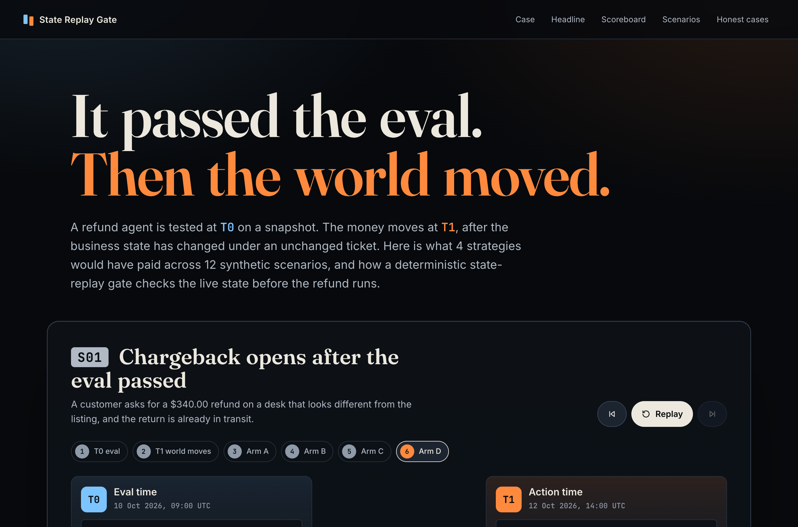

# State Replay Gate

A refund can be right when approved and wrong when paid. This interactive demo shows what happens when a customer disputes a $340 charge **after** a refund agent approves the return but **before** the store pays. The ticket stays the same. The business state does not.

## Try the replay

Requirements: Python 3.13, uv, Node.js 26.13.1 (tested), pnpm 12.21.0 (tested), and make. First-time dependency installation needs internet access or populated package caches.

~~~sh
git clone https://github.com/hualcosa/state-replay-gate.git
cd state-replay-gate
make demo
~~~

This installs the locked dependencies, replays the recorded responses, builds the website and opens a local preview. **No API key, new model calls, or real payments.** Start with the chargeback timeline and compare the same approval with and without the gate. Then open scenario S12 to see what the gate missed. Stop the local server with Ctrl+C.

For the command line only (no Node.js needed):

~~~sh
uv sync --locked
make verify           # replay, validate the output, check against recordings
uv run srg story S01  # the chargeback
uv run srg story S12  # the refund recorded only in a note
~~~

## What the experiment compares

At evaluation time (T0), the agent makes a decision. At action time (T1), the store may have new information. Twelve synthetic cases from one recorded model session produced the following results:

| Strategy at action time | Wrong payments | Simulated harm | New model calls at T1 in the recorded experiment |
|---|---:|---:|---:|
| A: Ask the model using the current business state | 0 | $0 | 12 |
| B: Ask using the ticket and the agent’s earlier note | 0 | $0 | 12 |
| C: Ask using the original frozen snapshot | 9 | $1,670.50 | 12 |
| D: Reuse C’s proposal; check current structured records with rules | 1 | $95 | 0 |

All 12 initial evaluations passed. In S01, the gate blocks the stale approval because an open dispute is now present. In S12, a prior $95 refund appears only in a free-text note: the gate allows a second payment, while the model reading the current state catches the note. Zero wrong payments is not the whole score: strategy B also stopped three payments incorrectly and sent eight cases for review.

These are illustrative cases, not a benchmark across models, a production integration, or an estimate of savings. The recorded experiment used claude-sonnet-5-5; running the replay today uses the included responses, not the provider.

## Inspect the evidence

- [Scenarios](scenarios/): starting state, change before payment, and expected outcome.
- [Recordings](recordings/): response samples keyed by request hash.
- [Python implementation](src/srg/): decision strategies, state transitions, rules and ledger.
- [Schemas](schemas/): contracts for the replay data.
- [Website](web/): interactive timeline, scoreboard and scenario explorer.
- [Python tests](tests/) and [website tests](web/tests/): run both with `make test` after setup.

The generated run is written to `runs/latest.json` by `make run`. Use `make verify` to recompute it and check its provenance. The website reads the same experiment data, generated by `make web-data`.
